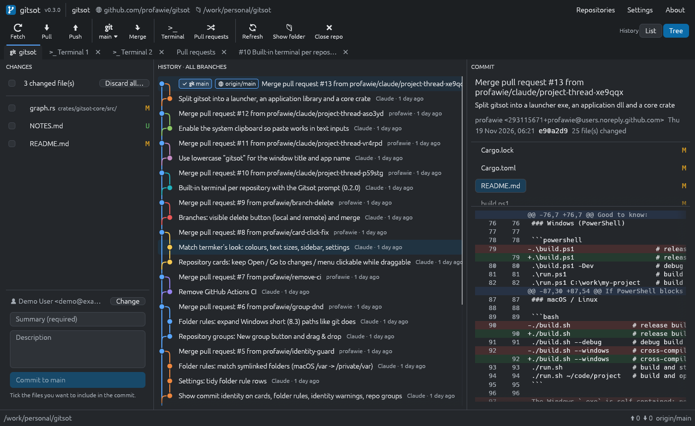
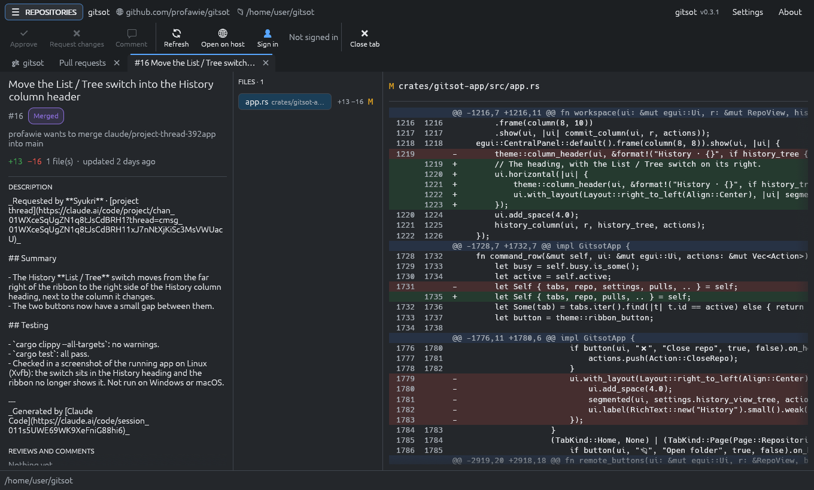
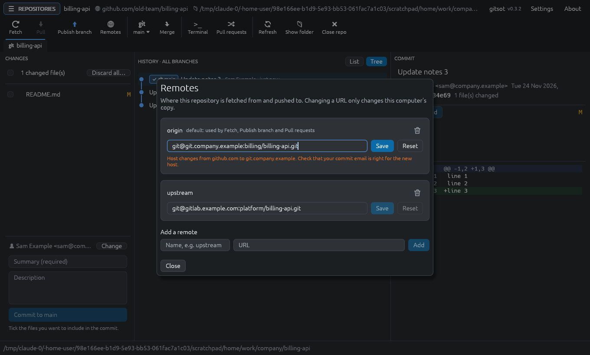

# Gitsot

A simple, friendly desktop Git client written in Rust. Same idea as GitHub Desktop, with fewer buttons.

Runs on **Windows** and **macOS** (Linux works too). Built with [egui/eframe](https://github.com/emilk/egui) for the UI, [git2](https://github.com/rust-lang/git2-rs) (libgit2) for local Git work and [alacritty_terminal](https://crates.io/crates/alacritty_terminal) for the built-in terminal.

## Features



- **One window, tabs and a ribbon**: there is no sidebar. The ribbon at the top starts with the **REPOSITORIES** button (your list of repositories), then shows the open repository with **where it comes from** (the remote) and **its folder**, and the buttons of the tab you are looking at. The app name and version are on the right, next to Settings and About. Under it is the tab strip.
- **The first tab** is pinned and shows three columns: **Changes**, **History** and the selected **Commit**. No switching back and forth between changes and history.
- **Changes**: tick the files to include (stage), untick to unstage. Click a file and its coloured diff opens in **its own tab**, with *Stage*, *Discard* and *Copy path* in the ribbon. Close it with the × on the tab, the middle mouse button or <kbd>Ctrl</kbd>/<kbd>Cmd</kbd>+<kbd>W</kbd>. The tab closes by itself once the file is committed.
- **Commit**: summary + description, then *Commit to &lt;branch&gt;* (or <kbd>Ctrl</kbd>/<kbd>Cmd</kbd>+<kbd>Enter</kbd>). If your Git name/email are not set, Gitsot asks for them once.
- **Discard**: right-click a file (or *Discard all…*) to throw away changes, with a confirmation.
- **Branches**: switch, create, check out remote branches, and **merge** another branch into the current one (*Merge* in the ribbon). If a merge has conflicts, the files are marked `!` in Changes; fix them and commit, or *Abort merge*. Delete local or remote branches with the bin icon in the branch menu (never the branch you are on).
- **Remote**: Fetch, Pull and Push, with ahead/behind counts. New branches get a *Publish branch* button.
- **Remotes**: *Remotes* in the ribbon shows where the repository is fetched from and pushed to. **Change a remote's URL** (for example after the project moved to another host or you switch between HTTPS and SSH), add another remote or remove one. See [Remotes](#remotes) below.
- **History**: switch between a **Tree** view (the default) (coloured branch graph with branch, remote and tag labels) and a simple **List**. Rest the pointer on a commit to see its **commit date and time**. The third column shows the selected commit, its files and a diff; double-click a file to open it in a tab.
- **Terminal**: *Terminal* in the ribbon starts a shell in the repository folder, in a new tab. Click it again for **another session in another tab**. See [Terminal](#terminal) below.
- **Pull requests**: list them, read the description, files and reviews, then **approve**, **request changes** (reject) or **comment**, each pull request in its own tab. See [Pull requests](#pull-requests) below.
- **Repositories**: your repositories as cards showing the branch, host and the **name/email that commits will use**. Organise them into **groups**: click *New group*, then drag cards onto a group: the card lifts off the page and follows the pointer, and a line under it says what dropping there does (or use the card menu ☰ → *Move to group…*). Rename or delete a group with the pencil and bin icons next to its name, and click its name to fold it. Open a local folder, clone from a URL, or create a new one.
- Settings and About pages (top right), light and dark theme, auto-refresh when the window regains focus, <kbd>F5</kbd> to refresh.

## Identities (work vs personal accounts)

Settings → **Identity** has two tabs:

- **Global**: the name/email used everywhere by default (`~/.gitconfig`).
- **This repository**: a name/email for the open repository only (`.git/config`).

Settings → **Folder rules** lets you say "every repository inside `C:\work\company` commits as `me@company.com`". Gitsot writes a standard Git `includeIf "gitdir:…"` rule, so it also applies to `git` on the command line and to other tools.

Before a **commit**, if the email that would be used is different from the folder rule, Gitsot stops and offers *Use the rule's email and commit*, *Commit anyway*, or *Cancel*. Before a **push**, it checks every commit that is about to be sent and warns if any was authored with a different email.

Gitsot works with any Git host (GitHub, GitLab, Bitbucket, Gitea, self-hosted servers, …). It never uses `gh` or any host-specific tool. Only [pull requests](#pull-requests) need the host's own API.

Clone, fetch, pull and push use the `git` command installed on your computer, so saved credentials and SSH keys keep working. Credential helpers are never allowed to open their own sign-in windows (such as Git Credential Manager's GitHub page). When an HTTPS remote needs a password and nothing is saved, Gitsot shows one plain *Sign in* dialog (username + password or access token), and your credential store remembers it if one is configured. Everything else is done in-process with libgit2.

## Pull requests



Click **Pull requests** in the ribbon. The list opens in a tab (*Open*, *Closed*, *All*); click a pull request and it opens in its own tab with its description, reviews and comments, the changed files and their diffs. The ribbon then has **Approve**, **Request changes** and **Comment**. Each asks for your comment and shows **which account the review is made as** before anything is sent.

- **Which account?** For an HTTPS remote, gitsot uses the sign-in Git has saved for that remote, so you review as the account that pushes. For an SSH remote (or to use another account) click *Sign in* and enter an access token. The token is kept in memory for the session and is never saved. The ribbon always shows *Reviewing as @name*.
- **Which hosts?** Pull requests go through a small provider interface (`crates/gitsot-core/src/forge.rs`), so the rest of gitsot does not know which host it talks to. This version has a provider for **GitHub** (github.com and GitHub Enterprise; for an Enterprise server with its own name, open Pull requests once and click *… is a GitHub Enterprise server*). GitLab, Gitea / Forgejo and Bitbucket are recognised and reported as not supported yet.
- **How?** Requests are sent with the `curl` command that ships with Windows 10+ and macOS, so the system certificates and proxy settings apply. gitsot still never uses `gh`.
- Not in this version: comments on single lines of a diff, merging or closing a pull request, and creating one.

## Remotes



Click **Remotes** in the ribbon (or the *local only* label at the top when the repository has no remote yet).

- **Change a URL**: edit the address and click *Save*. Any address Git understands works: `https://…`, `ssh://…`, `git@host:user/project.git` or a folder. If the host changes, Gitsot says so before you save, as a reminder to check that your commit email is right for the new host.
- **Add** a remote with a name and a URL, or **remove** one with the bin icon (after a confirmation). Removing only forgets the remote on this computer: nothing changes on the server.
- The first remote in the list (`origin` when there is one) is the default: Fetch, *Publish branch* and Pull requests use it.
- If a remote has a separate push URL (`pushurl`), it is shown and can be edited or cleared too.
- When the default remote's URL changes, open pull request tabs are closed and the pull request sign-in is forgotten, so a token for the old host or account is never sent to the new one.

## Terminal

Clone or open a repository, click **Terminal**, and you are in a shell inside that folder, in a new tab. Every click starts another session in another tab. No separate terminal window to open and `cd` around in.


- **Windows**: PowerShell (PowerShell 7 `pwsh` if it is installed, otherwise Windows PowerShell).
- **macOS**: zsh, started as a login shell like Terminal.app. **Linux**: your zsh or bash.

Your own shell profile is loaded as usual. After it, Gitsot adds its own prompt: before every command, one line of labelled chips shows

| Chip | Meaning |
| --- | --- |
| folder | where you are, relative to the repository |
| branch | the current branch (or `detached at <commit>`) |
| `2 to push` / `1 to pull` / `not published` | how the branch compares with its remote |
| `1 staged, 2 changed, 1 new` or `clean` | what is waiting to be committed; conflicts get their own red chip |
| person | the **email your next commit will use**, so a work/personal mix-up is visible before you commit |
| clock, `exit 1` | how long the last command took (3 s or more) and whether it failed |

The chips and icons are drawn by Gitsot itself: no Nerd Font, oh-my-posh or other install is needed. The files of your own shell setup are never changed. Prefer your own prompt? Turn off Settings → Terminal → **Gitsot prompt**.

Good to know:

- Terminals keep running while you look at other tabs or repositories. <kbd>Ctrl</kbd>+<kbd>`</kbd> jumps to the repository's last terminal (starting one if there is none) and back to the first tab. *Restart* starts a fresh shell in the same tab; closing the tab or the repository ends it.
- When a command finishes, Changes and History are refreshed, so what you did in the terminal shows up right away.
- Copy with <kbd>Ctrl</kbd>+<kbd>C</kbd> when text is selected (otherwise it interrupts, as usual) or <kbd>Ctrl</kbd>+<kbd>Shift</kbd>+<kbd>C</kbd>; paste with <kbd>Ctrl</kbd>+<kbd>V</kbd> (<kbd>Cmd</kbd>+<kbd>C</kbd>/<kbd>V</kbd> on macOS). Scroll back with the mouse wheel or <kbd>Shift</kbd>+<kbd>PageUp</kbd>.

## Requirements

- [Rust](https://rustup.rs) (stable)
- [Git](https://git-scm.com) on your PATH (for clone/fetch/pull/push)
- `curl` on your PATH for pull requests (already part of Windows 10+ and macOS)
- **Windows**: the GNU toolchain is used (`x86_64-pc-windows-gnu`, not MSVC) and needs MinGW-w64 `gcc`:
  ```powershell
  winget install MSYS2.MSYS2
  C:\msys64\usr\bin\pacman.exe -S --needed mingw-w64-x86_64-gcc
  ```
  `build.ps1` picks up `C:\msys64\mingw64\bin` automatically and installs the `stable-x86_64-pc-windows-gnu` Rust toolchain if needed.
- **macOS**: Xcode command line tools (`xcode-select --install`).

## Build and run

### Windows (PowerShell)

```powershell
.\build.ps1                     # release build -> dist\gitsot\
.\build.ps1 -Dev                # debug build
.\run.ps1                       # build and start
.\run.ps1 C:\work\my-project    # build and open a specific repository
```

If PowerShell blocks the scripts, run once: `Set-ExecutionPolicy -Scope CurrentUser RemoteSigned`.

### macOS / Linux

```bash
./build.sh                # release build -> dist/gitsot/
./build.sh --debug        # debug build
./build.sh --windows      # cross-compile for Windows -> dist/gitsot/ (needs mingw-w64)
./run.sh                  # build and start
./run.sh ~/code/project   # build and open a specific repository
```

### The release folder

Every build puts a ready-to-use release in `dist/gitsot`. It holds every file gitsot needs, so you can copy that one folder anywhere (another drive, another computer) and run gitsot from there:

| Platform | Contents of `dist/gitsot` |
| --- | --- |
| Windows | `gitsot.exe` (the program you start, with the gitsot icon) and `gitsot.dll` (the application) |
| macOS | `gitsot.app`, with `libgitsot.dylib` inside `Contents/Frameworks` |
| Linux | `gitsot` (the program you start) and `libgitsot.so` (the application) |

Keep the files together: the program looks for the library in its own folder. On Windows no MinGW DLLs are normally needed, because Rust links them statically; if your MinGW setup does need some (for example `libwinpthread-1.dll`), `build.ps1` and `build.sh --windows` find them and copy them into the folder too.

## Project layout

gitsot is a Cargo workspace with three crates, built the way desktop applications usually are: a small executable that loads one shared library.

```
gitsot.exe ──loads──▶ gitsot.dll ──contains──▶ gitsot-core
(launcher)            (gitsot-app: the UI)     (Git, identities, terminal, pull requests)
```

| Crate | Builds | What it does |
| --- | --- | --- |
| `crates/gitsot` | `gitsot.exe` / `gitsot` | The launcher. Finds the library next to itself, checks it is the same version, and starts it. Shows a message if the library is missing. |
| `crates/gitsot-app` | `gitsot.dll` / `libgitsot.so` / `libgitsot.dylib` | The application: window and the whole UI. Exports `gitsot_main` and `gitsot_version` with a C interface. |
| `crates/gitsot-core` | Rust library (linked into the dll) | Everything that is not UI. No dependency on the UI toolkit, so it can be tested on its own. |

| File | What it does |
| --- | --- |
| `crates/gitsot/src/main.rs` | The launcher |
| `crates/gitsot/build.rs`, `assets/gitsot.rc`, `assets/gitsot.ico` | Put the gitsot icon into `gitsot.exe` on Windows (compiled with MinGW's `windres`). The `.ico` is generated from the logo by a test in `theme.rs` |
| `crates/gitsot-app/src/lib.rs` | Window setup and the exported entry points |
| `crates/gitsot-app/src/app.rs` | Most of the UI: ribbon, tabs, the three columns (changes, history, commit), repository cards, settings, dialogs, diff viewer |
| `crates/gitsot-app/src/pulls.rs` | Pull requests: the list tab, one tab per pull request, the review and sign-in dialogs |
| `crates/gitsot-app/src/theme.rs` | Colours, text sizes and widgets (same look as termker), ribbon buttons, tabs, logo, cards |
| `crates/gitsot-app/src/term_view.rs` | Draws the terminal, including the prompt's chips and icons, and handles keys and mouse |
| `crates/gitsot-core/src/git.rs` | Local Git operations with libgit2 (status, diff, stage, commit, branches, history) |
| `crates/gitsot-core/src/identity.rs` | Global/repository identities, folder rules (`includeIf`) and mismatch checks |
| `crates/gitsot-core/src/graph.rs` | Lays out the history tree (lanes and branch lines) |
| `crates/gitsot-core/src/cli.rs` | Network operations through the `git` command, run in the background |
| `crates/gitsot-core/src/forge.rs` | Pull requests on the Git host: the provider interface, the GitHub provider, requests through `curl` |
| `crates/gitsot-core/src/term.rs` | One built-in terminal: the shell in a pseudo-terminal and its screen (`alacritty_terminal`) |
| `crates/gitsot-core/src/shell.rs` | Picks the shell (PowerShell / zsh / bash) and loads the Gitsot prompt into it |
| `crates/gitsot-core/assets/prompt.ps1`, `prompt.sh` | The Gitsot prompt for PowerShell and for zsh/bash |

## Tests

```bash
cargo test
```
